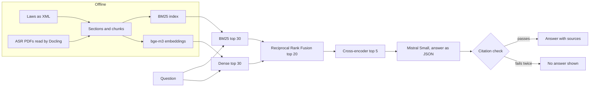

# Sicherheitslotse

[](https://github.com/fAmesteR/sicherheitslotse/actions/workflows/ci.yml)

Beantwortet Fragen zum deutschen Arbeitsschutz, mit exakten Quellenangaben und gemessener Qualität.

Answers questions about German occupational-safety rules, with exact citations and measured quality.

**Status: in development.** Search over 11 laws and 5 technical rules works, and the answer step
with its citation check is built. A Gradio demo runs locally on the 11 laws. Answer quality isn't
measured yet: that needs the test set, which comes next along with the public demo.

| Part | State |
|---|---|
| 11 laws and ordinances, parsed from XML | done |
| 5 of the 14 technical rules, parsed from PDF | done |
| Hybrid search and reranking, 1,554 chunks | done |
| Reranker timing on CPU and ZeroGPU | done |
| Answers with a deterministic citation check | built, not measured yet |
| Refusal when the sources don't cover a question | built, score threshold not tuned yet |
| Answer evaluation with an LLM judge | built, waiting for reviewed questions |
| CI: lint and unit tests on every push | done |
| Gradio demo on the 11 laws, run locally | done |
| 100-question test set and the retrieval quality gate in CI | next |
| Public Gradio demo on Hugging Face ZeroGPU | prepared, not deployed yet |

## How it works



- **Every chunk can be cited.** It keeps its document, its § or section number, its page, its source
  URL and its version date.
- **Two searches, because they fail differently.** BM25 finds exact terms such as `§ 5`. The bge-m3
  embeddings find passages when someone asks in everyday words.
- **Reciprocal Rank Fusion merges the two lists** by rank, so their scores never have to be compared.
- **A cross-encoder reads the top 20 again**, question and passage together, and keeps the best 5.
- **The index stays in memory.** A few thousand chunks fit in NumPy, so there is no vector database.
  Docling runs once, offline, and the app doesn't depend on it.
- **The model answers in a fixed schema:** the text with `[n]` markers, plus one verbatim quote per
  source it uses.
- **Code decides what is shown, not the model.** The check in
  [`answer.py`](src/lotse/generation/answer.py) lets an answer through only if every sentence names
  a source, every quote is word for word in its passage, and every number in a sentence appears in a
  source that sentence names or in the question. A quote may differ in case, spacing and list labels
  such as "a)", but not in a single word. "8 Stunden" matches "acht Stunden", and the 2 in "m²"
  counts for nothing. A failed answer gets one retry that is told what was wrong. After a second
  failure no answer is shown.

The check catches an invented quote or number. It can't tell whether a real quote supports its
sentence, so an LLM judge will measure that separately.

## Measurements

Median time to rerank 20 passages, over 8 questions:

| Model | Hardware | Median |
|---|---|---:|
| `bge-reranker-v2-m3` | ZeroGPU, queue included | 0.36 s |
| `bge-reranker-v2-m3` | 12 CPU threads | 25.8 s |
| `bge-reranker-v2-m3` | 2 CPU threads | 59.9 s |
| `mmarco-mMiniLMv2-L12-H384-v1` | 2 CPU threads | 2.5 s |

The better model only works on a GPU, so the small one stays as the fallback. The ZeroGPU runs were
at a quiet hour with one caller, so the live demo's median will be the real test. Every run is in
[`eval/results/rerank_timing.jsonl`](eval/results/rerank_timing.jsonl).

Search quality isn't quoted yet. `eval/run_retrieval.py` reports Recall@5 and MRR@10 with 95%
intervals, but the runs so far use 28 draft questions that nobody has reviewed. The numbers will go
here once the reviewed test set has run.

## What didn't work

**A clean-looking metric picked the wrong parser model.** I converted the PDFs with three Docling
layout models and first preferred `egret_xlarge`, which left no bare values outside a table. My check
only matched bare numbers, though, so it missed values with words around them. Checking the disputed
tables against the PDFs showed the real result:

| Layout model | Tables found | Bare values left loose | Disputed rows right | Other tables |
|---|---:|---:|---:|---|
| default | 34 | 8 | 0 of 7 | right |
| `egret_xlarge` | 37 | 0 | 7 of 7 | 3 values outside their table, a sentence mixed into a row |
| `heron_101` (chosen) | 38 | 0 | 7 of 7 | right |

**A check passed while a requirement vanished.** Docling labelled a list item as a heading, so its
text opened an empty section and never reached a chunk. My number check ran before that step and
stayed green. `scripts/check_pdfs.py` now compares the final sections with the PDF's own text layer,
a source independent of Docling, line by line: 2,330 lines across the five files.

**My footer filter deleted a real sentence.** Docling had glued a footer to a sentence running over
the page, and the whole block looked like a footer. The filter now cuts the footer out and keeps the
rest.

## Run it

The tests need no data:

```bash
uv sync
uv run pytest
```

To build the index, first save the PDFs by hand into `data/raw/pdf`, because BAuA's site blocks
scripts. `download.py` fetches the laws, names any PDF that is missing, and records each file's hash
in the manifest.

```bash
uv run python scripts/download.py
uv run python scripts/ingest.py
uv run python scripts/build_index.py
uv run python eval/run_retrieval.py
```

`build_index.py` takes about 10 minutes on a laptop CPU. `run_retrieval.py --rerankers bge small`
also scores the reranked setups, which takes about 15 minutes on a CPU.

To ask a question, put a Mistral API key into `.env` as `MISTRAL_API_KEY=...`. That file is
gitignored.

```bash
uv run --env-file .env python -m lotse.pipeline "Wie lange darf ich pro Tag arbeiten?"
```

Add `--show-prompt` to see the passages and the exact prompt without calling the API. On a CPU the
reranker makes one question take about a minute.

To open the demo in a browser, at `http://localhost:7860`:

```bash
uv run --env-file .env python app/app.py
```

It shows the answer and, for each source, the passage with the quoted words marked and a link to
the original. It searches the 11 laws only. A visitor gets 10 questions per 10 minutes and 300
characters per question, and a repeated question is answered from memory without an API call.

To publish the demo to a Hugging Face Space, after `hf auth login`:

```bash
uv run python scripts/publish_index.py --upload
uv run python scripts/deploy_space.py --upload
```

The first writes an index of the 11 laws alone, 1,044 of the 1,554 chunks, and uploads it to a
private dataset. The second pushes the app, the package, `requirements.txt` and
[`space/README.md`](space/README.md) to the Space. It takes only files that git tracks. The Space
downloads the index at startup and runs embedding and reranking in one ZeroGPU function, so a
visitor's GPU quota pays for model time only.

The laws-only index is not the full index with a filter. BM25 scores a word by how rare it is, and
that changes when 510 chunks leave: on the 28 dev questions, 12 get one or two different candidates
out of 20. Numbers for the public demo therefore have to be measured on the index it uses.

To measure the answers on the dev split:

```bash
uv run --env-file .env python eval/run_answers.py --runs 3
```

It reports the answer rate, citation validity and refusal rate from the pipeline, and lets a second
model judge correctness and faithfulness with the prompts in
[`eval/judge_prompt.md`](eval/judge_prompt.md). The answer model is not repeatable even at
temperature 0, so every setup is run three times.

Use the full ASR texts: a "Textauszug" change sheet prints deleted wording as if it were current, and
`ingest.py` refuses one, as it does a file whose version differs from `lotse.config`.

Docling reads each PDF once and `data/parsed` keeps the result, which takes about 20 minutes for five
PDFs on a CPU. After parsing a new PDF, run:

```bash
uv run python scripts/check_pdfs.py
```

It compares the PDF's own text layer with the final sections. Figure captions, drawing labels and
Literaturhinweise are meant to be missing. Anything else is a parsing bug.

## Data sources and licensing

This repository holds code, test questions on the laws, and hashes. The source documents and the
index stay local.

| Source | Used for | Terms |
|---|---|---|
| [Gesetze im Internet](https://www.gesetze-im-internet.de) | 11 laws and ordinances | No copyright protection, § 5 Abs. 1 UrhG |
| [BAuA](https://www.baua.de/DE/Angebote/Regelwerk/ASR) ASR | 5 technical rules so far | Private, non-commercial use without consent |
| DGUV | Excluded | Its terms forbid processing its publications with AI |

No ASR text is published here, and none is sent to the answer API: `API_DOCS` in `lotse.config`
limits the passages that can leave the machine to the laws. I asked BAuA for written permission on
2026-11-01. If it declines or doesn't reply by 2026-12-06, the public demo will run on the 11 laws
alone.

## Limitations

This is a portfolio project, not legal advice. Always check the original source. For the ASR, the
text published in the GMBl is binding, and BAuA's PDFs are marked as unofficial.

- A footnote under a table can land in its last row. The numbers stay right.
- Text inside drawings isn't indexed.
- A section's page is the page it starts on.
- Chunks don't overlap. Sections are split at their own paragraphs, and only 7 of the 510 ASR chunks
  come from a further cut.
- The citation check reads "zwei" to "zwölf" as numbers, but not "ein" or "eine".
