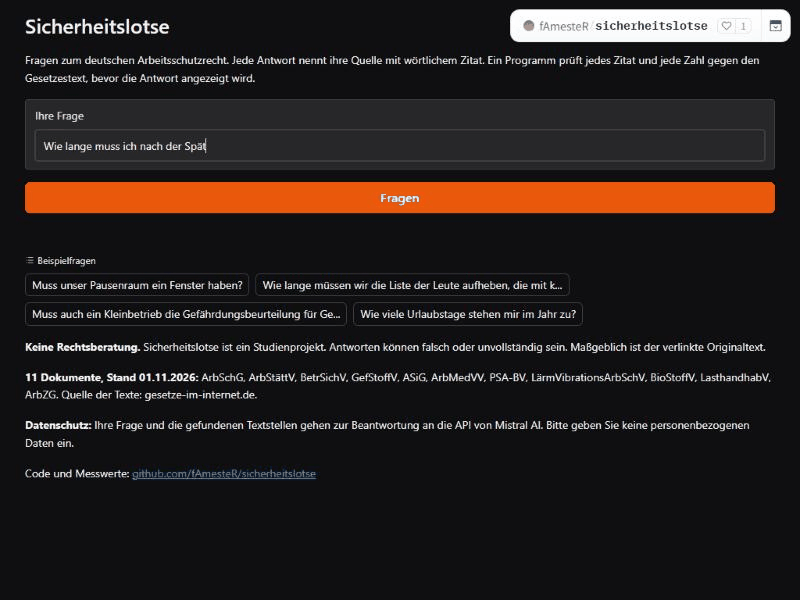
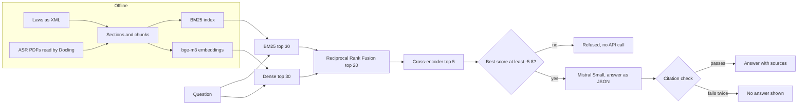

# Sicherheitslotse

[](https://github.com/fAmesteR/sicherheitslotse/actions/workflows/ci.yml)

Beantwortet Fragen zum deutschen Arbeitsschutz, mit exakten Quellenangaben und gemessener Qualität.

Answers questions about German occupational-safety rules, with exact citations and measured quality.



**Live demo: [huggingface.co/spaces/fAmesteR/sicherheitslotse](https://huggingface.co/spaces/fAmesteR/sicherheitslotse)**, on the 11 laws. The Space sleeps
when nobody uses it, and the first visitor after that waits a minute or two while it starts.

**Status: in development.** The numbers below are a first reading: the 100 questions were
drafted by an LLM and not yet reviewed by hand, and the 20 test questions have not been run.

## Measurements

### Quality on the dev questions

80 of the 100 questions form the dev split: 60 that the 11 laws answer and 20 that they don't.
An LLM drafted all of them, and a script checked every source label and key fact against the law
text. They are not reviewed by hand yet, so read these numbers as a first reading. Search ran on
the laws-only index of 1,044 chunks, the one the public demo uses.

| Search setup | Recall@5 | MRR@10 |
|---|---|---|
| BM25 only | 0.42 | 0.35 |
| Dense only (bge-m3) | 0.73 | 0.71 |
| Hybrid (RRF) | 0.67 | 0.54 |
| Hybrid + `mmarco-mMiniLMv2-L12-H384-v1` | 0.78 | 0.66 |
| Hybrid + `bge-reranker-v2-m3`, prefix for both | 0.80 | 0.73 |
| **Hybrid + `bge-reranker-v2-m3`, reranker without the prefix (the demo's setup)** | **0.83** | **0.74** |
| No context prefix anywhere | 0.85 | 0.74 |
| No context prefix: dense only | 0.68 | 0.64 |

n = 60. The 95% interval for 0.83 is 0.72 to 0.91. Every chunk is searched with a prefix such as
"ArbZG § 5 Ruhezeit:" in front. It helps dense search (0.73 against 0.68), but the reranker
judges better without it, mostly on everyday wording (11 of 12 against 9 of 12). It isn't
truncation: no chunk reaches the reranker's limit of 512 tokens either way. So search keeps the
prefix and the reranker reads the bare text. Removing the prefix everywhere gains one more
question, which is within noise and would need a new index.

| Answers, mean of three runs | Value | 95% interval | Out of, per run | Spec target |
|---|---|---|---|---|
| Answer rate | 0.78 | 0.66 to 0.87 | 60 answerable questions | ≥ 0.90, missed |
| Citation validity: first replies that pass the check | 0.77 | 0.66 to 0.87 | about 59 replies | |
| Correctness: judged correct against the reference, "partly" counts as not correct | 0.84 | 0.72 to 0.92 | about 46 shown answers | ≥ 0.75 |
| Faithfulness: sentences the judge finds supported by their source | 0.91 | 0.83 to 0.96 | about 79 sentences | ≥ 0.90 |
| Refusal, all unanswerable questions | 18 of 20 in every run | 0.70 to 0.97 | | ≥ 0.80 |
| Refusal, of those near-domain | 8 of 10 in every run | | | |
| API time per answer, p50 and p95 | 1.3 s and 3.1 s | | | |
| API cost per answer | $0.00035 | | | < 1 cent |

The intervals use the per-run n, so they don't pretend three runs are three times the questions.
The runs agree closely: answer rate 0.75, 0.78 and 0.82. Mistral Small writes the answers and
Mistral Large judges them. In 3 of the 141 shown answers the judge returned no valid verdict, and
correctness leaves those out. I haven't yet checked the judge's verdicts
against my own. Every run is in
[`eval/results`](eval/results), and [`eval/baseline.json`](eval/baseline.json) holds what CI
compares against.

### The live demo

30 different dev questions asked of the live Space right after a restart, timed two ways, on the
current version (`d44fc6d`):

| | p50 | p95 |
|---|---:|---:|
| In the app, question in to answer out (its `/metrics`) | 2.0 s | 3.7 s |
| For a visitor, network and queue included | 2.6 s | 4.6 s |

With n = 30, p95 is the second-slowest question. The slowest for a visitor, 9.4 s, was the first
question after the restart. The Mistral API cost $0.0094 for the 30, which is **$0.31 per 1,000
queries** on this mix of 23 answerable and 7 unanswerable questions; 21 were answered and 9
refused. The GPU is paid for by the flat Hugging Face PRO plan. The same 30 questions on the two
earlier versions gave a visitor median of 2.5 and 2.3 s, so the differences are within the noise
of a network and an API. All three runs are in [`eval/results`](eval/results), named
`..._live.json`.

### Reranker speed

Median time to rerank 20 passages, over 8 questions:

| Model | Hardware | Median |
|---|---|---:|
| `bge-reranker-v2-m3` | ZeroGPU, queue included | 0.36 s |
| `bge-reranker-v2-m3` | 12 CPU threads | 25.8 s |
| `bge-reranker-v2-m3` | 2 CPU threads | 59.9 s |
| `mmarco-mMiniLMv2-L12-H384-v1` | 2 CPU threads | 2.5 s |

The better model only works on a GPU, so the small one stays as the fallback. The ZeroGPU runs were
at a quiet hour with one caller. The live demo's times, with everything around the reranker, are
above. Every run is in
[`eval/results/rerank_timing.jsonl`](eval/results/rerank_timing.jsonl).

## How it works



- **Every chunk can be cited.** It keeps its document, its § or section number, its page, its source
  URL and its version date.
- **Two searches, because they fail differently.** BM25 finds exact terms such as `§ 5`. The bge-m3
  embeddings find passages when someone asks in everyday words.
- **Reciprocal Rank Fusion merges the two lists** by rank, so their scores never have to be compared.
- **A cross-encoder reads the top 20 again**, question and passage together, and keeps the best 5.
  Search sees each chunk with its law, § and heading in front; the cross-encoder sees the bare
  text, which measured better.
- **The index stays in memory.** A few thousand chunks fit in NumPy, so there is no vector database.
  Docling runs once, offline, and the app doesn't depend on it.
- **The model answers in a fixed schema:** the text with `[n]` markers, plus one verbatim quote per
  source it uses.
- **Code decides what is shown, not the model.** The check in
  [`answer.py`](src/lotse/generation/answer.py) lets an answer through only if every sentence names
  a source, every quote is word for word in its passage, and every number in a sentence appears in a
  source that sentence names. A quote may differ in case, spacing and list labels such as "a)", but
  not in a single word, and it must start and end on a whole word. A number from the question backs
  nothing. "8 Stunden" matches "acht Stunden", number words count up to "hundert", "einen Monat"
  counts as 1 and "halb" as 0.5, and the 2 in "m²" counts for nothing. A failed answer gets one
  retry that is told what was wrong. After a second failure no answer is shown.

The check catches an invented quote or number. It can't tell whether a real quote supports its
sentence: one that turns "mindestens" into "höchstens", or makes a claim with no number in it,
passes. An LLM judge measures that separately as faithfulness, and the demo page asks visitors to
compare each sentence with its highlighted quote.

## What didn't work

**Near-domain questions get answered from a neighbouring rule.** Asked how long a 16-year-old
trainee may work, the system answered "8 hours" from the Arbeitszeitgesetz, which doesn't apply
to minors. In the first run 7 of 10 such questions got an answer. The citation check can't catch
this, because the quote is real. A rerank-score threshold doesn't separate them either: a cut at 0
refuses 19 of the 20 unanswerable questions but also drops 19 of the 49 good answers. The
threshold the app uses, -5.8, sits in the gap below the lowest answerable dev question (-5.00).
It refuses 7 off-topic and 1 near-domain question before any API call and costs no answerable
one. The other near-domain questions score too high for it, so the prompt rule below has to do
that work.

What helped was one rule in the prompt: check that a source covers the same group of people, the
same role and the same subject, or refuse. I compared two wordings, three runs each, without the
judge. The rule raised near-domain refusals from 4 to 5 of 10 to 8 to 9 of 10, and cost about 3
of 60 answerable questions. A second wording that also named the laws' scope did no better and
named topics from the dev questions, so I kept the plain one. With the judge it refused 7 of 10,
and 8 of 10 once the reranker read the bare text. Still answered in every run: night work while
pregnant and the site safety coordinator, where a neighbouring rule reads like a fit. This is the
main open problem.

**The number check let one invented number through.** "Mindestens zwei Ersthelfer" passed,
because the passage contains the paragraph label "(2)". Now a number a sentence states must be a
value in its source: list labels, "§ 5", "Abs. 2" and the like don't count, and a digit glued to a
letter ("m²" after normalisation, "M1.2") is no number. Tests cover each case.

**A code review found more ways past the check.** A quote could start in the middle of a word, so
"zulässig, wenn der Arbeitnehmer krank ist" was found inside "unzulässig, wenn …". A number counted
as backed when it came from the question, so after "Darf ich 14 Stunden am Tag arbeiten?" the
sentence "Sie dürfen 14 Stunden arbeiten [1]" passed with any real quote. And "zwanzig" or "eine
Woche" weren't read as numbers at all. All three are closed and tested. None of the 147 answers
shown in the three dev runs fails the stricter check, so the numbers above still hold.

The review also asked for a check on meaning. I tried two rules against the judge's verdicts on
the 238 sentences of those runs, 21 of which it found unsupported. Requiring a sentence to share a
content word with its quotes would catch 3 of the 21 and reject 2 supported sentences. Flagging a
"nicht" or "kein" on one side only would catch 4 and reject 20. Neither earns its place, and a
reversed limit shares its words with the quote anyway. A model trained for entailment (NLI) could
do this, at the cost of a third model.

**The live demo reloaded the reranker for every question.** The app loads it at startup with
`load()`, and the search called `load(name)`. `functools.cache` keeps those as two entries, so the
startup copy was never used. Locally that only cost a second load. On ZeroGPU, where each GPU call
runs in its own worker, every question loaded 2.3 GB again and took 5 to 7 s. Fixed, the same
questions take 2 to 3 s.

**Fusing the two searches is worse than dense search alone here**, 0.67 against 0.73 in
Recall@5, because BM25 alone reaches only 0.42 on everyday wording. The reranker more than makes
up for it (0.80).

**Questions that need two sections are the weak type.** Both sections are in the top 5 for 8 of
12. About 8 of 12 get an answer, and the judge rates about 5 of 12 fully correct, up from 1
before the reranker change. Most of the rest are "partly": the answer gives one section and
misses the other.

**A clean-looking metric picked the wrong parser model.** I converted the PDFs with three Docling
layout models and first preferred `egret_xlarge`, which left no bare values outside a table. My check
only matched bare numbers, though, so it missed values with words around them. Checking the disputed
tables against the PDFs showed the real result:

| Layout model | Tables found | Bare values left loose | Disputed rows right | Other tables |
|---|---:|---:|---:|---|
| default | 34 | 8 | 0 of 7 | right |
| `egret_xlarge` | 37 | 0 | 7 of 7 | 3 values outside their table, a sentence mixed into a row |
| `heron_101` (chosen) | 38 | 0 | 7 of 7 | right |

**A check passed while a requirement vanished.** Docling labelled a list item as a heading, so its
text opened an empty section and never reached a chunk. My number check ran before that step and
stayed green. `scripts/check_pdfs.py` now compares the final sections with the PDF's own text layer,
a source independent of Docling, line by line: 2,330 lines across the five files.

**My footer filter deleted a real sentence.** Docling had glued a footer to a sentence running over
the page, and the whole block looked like a footer. The filter now cuts the footer out and keeps the
rest.

**CI failed with nothing changed in the repository.** The workflows pinned the `setup-uv` action
by commit, but the action installed the newest uv. uv 0.13.9 came out one morning and wrote the
same lockfile into `requirements.txt` with its platform conditions in an equivalent but different
form, so the check that the two match failed. The packages were identical. Every workflow now
installs uv 0.13.6, the version the Docker image uses, and a test keeps the two equal. Pinning the
action wasn't enough: what it installs needed a pin too.

## Run it

With [uv](https://docs.astral.sh/uv/) and a Mistral API key in `.env` as `MISTRAL_API_KEY=...`,
three commands build the index of the 11 laws and open the demo at `http://localhost:7860`:

```bash
uv sync
uv run python scripts/download.py && uv run python scripts/ingest.py && uv run python scripts/build_index.py
uv run --env-file .env python app/app.py
```

The details:

The tests need no data:

```bash
uv sync
uv run pytest
```

To build the index, first save the PDFs by hand into `data/raw/pdf`, because BAuA's site blocks
scripts. `download.py` fetches the laws, names any PDF that is missing, and records each file's hash
in the manifest. `ingest.py` stops on a file whose hash differs from it.

```bash
uv run python scripts/download.py
uv run python scripts/ingest.py
uv run python scripts/build_index.py
uv run python eval/run_retrieval.py
```

`run_retrieval.py --gate` is the quality gate: it exits with an error if Recall@5 or MRR@10 of
hybrid search falls more than 0.02 below `eval/baseline.json`. CI runs it on every push, on the
pinned index downloaded fresh. `--save-baseline` stores a new baseline, which is its own commit.

`build_index.py` takes about 10 minutes on a laptop CPU. `run_retrieval.py --rerankers bge small`
also scores the reranked setups, which takes about 15 minutes on a CPU.

To ask a question, put a Mistral API key into `.env` as `MISTRAL_API_KEY=...`. That file is
gitignored.

```bash
uv run --env-file .env python -m lotse.pipeline "Wie lange darf ich pro Tag arbeiten?"
```

Add `--show-prompt` to see the passages and the exact prompt without calling the API. On a CPU the
reranker makes one question take about a minute.

To open the demo in a browser, at `http://localhost:7860`:

```bash
uv run --env-file .env python app/app.py
```

It shows the answer and, for each source, the passage with the quoted words marked and a link to
the original. It searches the 11 laws only. A visitor gets 10 questions per 10 minutes and 300
characters per question, and a repeated question is answered from memory without an API call.
Once the day's API calls have cost $1, the demo stops asking the model until the next day. On the
page four questions run at a time and up to 20 wait. Each call to the model gives up after 20 s,
and a rate limit, server error or dropped connection is retried with backoff for up to 15 s.

A visitor is the address the connection comes from. Behind a reverse proxy that address is the
proxy's, so the app then reads the visitor from `X-Forwarded-For`, but only when told it sits
behind one: on a Hugging Face Space by default, elsewhere with `LOTSE_TRUST_PROXY=1`. Otherwise
anyone could send a new address with every question.

The same page with a JSON API next to it, as the Docker image runs it:

```bash
uv run --env-file .env uvicorn server:api --app-dir app --port 7860
```

| Route | What it does |
|---|---|
| `POST /ask` with `{"question": "..."}` | The checked answer and its sources as JSON. 429 over the limit, which it shares with the page, 422 for a bad question, 503 if the model can't be reached or the day's budget is spent |
| `GET /health` | Answers once the index, the key and both models are loaded |
| `GET /metrics` | Queries by outcome, p50 and p95 latency, USD in total and per 1,000 queries |
| `GET /docs` | The API description that FastAPI generates |

Every query writes one JSON line to the server's output: time, outcome, seconds, prompt and
completion tokens, and cost at list price. The question and the visitor's address are not in it,
and the image turns off uvicorn's access log, which would write the address.

As a container:

```bash
docker build -t sicherheitslotse .
docker run -p 7860:7860 -e MISTRAL_API_KEY -e HF_TOKEN -v lotse-models:/data sicherheitslotse
```

The image installs from `uv.lock`, each package checked against its recorded hash, and takes the
CPU build of PyTorch instead of the CUDA one, checked against PyTorch's hash. Both base images are
pinned by digest. It holds no models: at its first start the container downloads
both models into the `/data` volume and the index from the private dataset. On a CPU the reranker
needs most of a minute per question: in a test run of the container one question took 59 s and
another 23 s, and a repeated one came from the cache at once.

To publish the demo to a Hugging Face Space, after `hf auth login`:

```bash
uv run python scripts/publish_index.py --upload
uv run python scripts/deploy_space.py --upload --wait
uv run python eval/run_live.py --smoke
```

The first writes an index of the 11 laws alone, 1,044 of the 1,554 chunks, and uploads it to a
private dataset. After an upload, set the commit it prints as `INDEX_REVISION` in `lotse.config`,
so the app and CI read the same index. The second pushes the app, the package, `requirements.txt`
and [`space/README.md`](space/README.md) to the Space, as they are in the last commit, so a change
that isn't committed never ships. `--wait` returns once the Space runs that commit, and stops with
the Space's own error message as soon as its build or start fails. The third asks the live Space
three known questions and fails unless two are answered with a source and one is refused. The
`deploy` job in [`ci.yml`](.github/workflows/ci.yml) runs the last two after the tests and the
Docker build pass on `main`, with a write token for the Space alone as the `HF_DEPLOY_TOKEN`
secret. That secret isn't set yet, so the job skips its steps and the Space is deployed by hand
with the same two commands. The Space downloads the index at startup and runs embedding and
reranking in one ZeroGPU function, so a visitor's GPU quota pays for model time only.

The models are pinned to a commit in `MODEL_REVISIONS` in `lotse.config`, and the Space preloads
those commits. The index's `meta.json` records the embedding model's commit and the SHA-256 of
every file, so the app refuses an index built with another model or changed after it was built.
`run_live.py` without `--smoke` times the 30 dev questions against the live Space and saves the
result to `eval/results`.

The Space's builder installs its own `spaces` and `gradio[mcp,oauth]` next to
`requirements.txt`, so `pyproject.toml` pins the same, or pip stops on a conflict. Hugging Face
now wants a paid plan to create a Gradio Space, so the script only uploads to one that exists.
The Space's API takes the same question as the page:

```python
from gradio_client import Client

Client("fAmesteR/sicherheitslotse").predict("Wie lange darf ich am Tag arbeiten?", api_name="/ask")
```

The laws-only index is not the full index with a filter. BM25 scores a word by how rare it is, and
that changes when 510 chunks leave: on the 28 dev questions, 12 get one or two different candidates
out of 20. Numbers for the public demo therefore have to be measured on the index it uses.

To measure the answers on the dev split:

```bash
uv run --env-file .env python eval/run_answers.py --runs 3
```

It reports the answer rate, citation validity and refusal rate from the pipeline, and lets a second
model judge correctness and faithfulness with the prompts in
[`eval/judge_prompt.md`](eval/judge_prompt.md). The answer model is not repeatable even at
temperature 0, so every setup is run three times.

Use the full ASR texts: a "Textauszug" change sheet prints deleted wording as if it were current, and
`ingest.py` refuses one, as it does a file whose version differs from `lotse.config`.

Docling reads each PDF once and `data/parsed` keeps the result, which takes about 20 minutes for five
PDFs on a CPU. After parsing a new PDF, run:

```bash
uv run python scripts/check_pdfs.py
```

It compares the PDF's own text layer with the final sections. Figure captions, drawing labels and
Literaturhinweise are meant to be missing. Anything else is a parsing bug.

## Status

| Part | State |
|---|---|
| 11 laws and ordinances, parsed from XML | done |
| 5 of the 14 technical rules, parsed from PDF | done; the other 9 wait for BAuA, whose site blocks scripts |
| Hybrid search and reranking, 1,554 chunks | done |
| Reranker timing on CPU and ZeroGPU | done |
| Answers with a deterministic citation check | done |
| Refusal when the sources don't cover a question | done: score threshold before the API, then the model |
| 100 questions: 75 answerable, 25 not | drafted by an LLM, hand review still open |
| Evaluation: Recall@5, MRR@10, citation validity, faithfulness | measured on the dev drafts |
| CI: lint, unit tests, lockfile check, Docker build, workflow lint (zizmor); actions pinned by commit, uv by version, Dependabot for the actions | done |
| Quality gate in CI on Recall@5 and MRR@10 | done: runs on every push and passes at the baseline |
| Gradio demo and JSON API (FastAPI) on the 11 laws | done |
| Latency and cost logged for every query | done |
| Docker image | builds in CI |
| Public deployment | live on a Hugging Face Space with ZeroGPU; each deploy ends with a three-question smoke check. CI's deploy job is built and waits for the `HF_DEPLOY_TOKEN` secret, so deploys are by hand until then |

## Data sources and licensing

This repository holds code, test questions on the laws, and hashes. The source documents and the
index stay local.

| Source | Used for | Terms |
|---|---|---|
| [Gesetze im Internet](https://www.gesetze-im-internet.de) | 11 laws and ordinances | No copyright protection, § 5 Abs. 1 UrhG |
| [BAuA](https://www.baua.de/DE/Angebote/Regelwerk/ASR) ASR | 5 technical rules so far | Private, non-commercial use without consent |
| DGUV | Excluded | Its terms forbid processing its publications with AI |

No ASR text is published here, and none is sent to the answer API: `API_DOCS` in `lotse.config`
limits the passages that can leave the machine to the laws. I asked BAuA for written permission on
2026-11-01. If it declines or doesn't reply by 2026-12-06, the public demo will run on the 11 laws
alone.

## Limitations

This is a portfolio project, not legal advice. Always check the original source. For the ASR, the
text published in the GMBl is binding, and BAuA's PDFs are marked as unofficial.

- A footnote under a table can land in its last row. The numbers stay right.
- Text inside drawings isn't indexed.
- A section's page is the page it starts on.
- Chunks don't overlap. Sections are split at their own paragraphs, and only 7 of the 510 ASR chunks
  come from a further cut.
- The citation check reads "ein" or "eine" as 1 only before a unit of time, since it is
  mostly the article. So "1 Meter" in an answer doesn't match "ein Meter" in its source, and the
  answer is rejected.
- The citation check compares words and numbers, not meaning. A sentence that reverses a limit
  or makes a claim with no number in it passes if its quote is real.
- The rate limit counts per address, so a visitor with many addresses gets more questions. The
  daily budget caps what that can cost.
